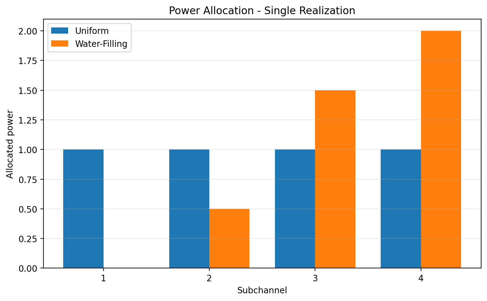
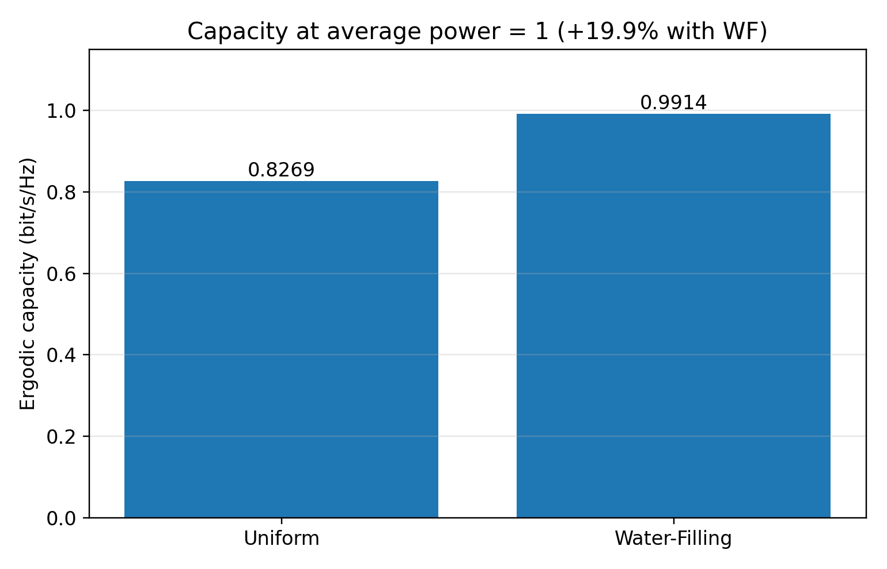
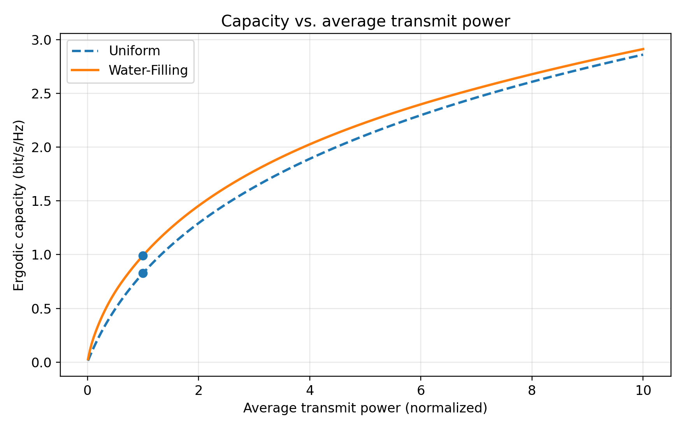
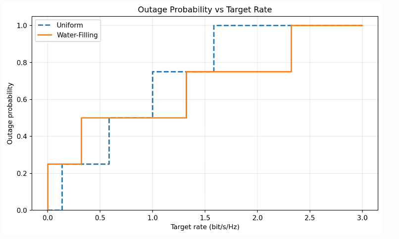
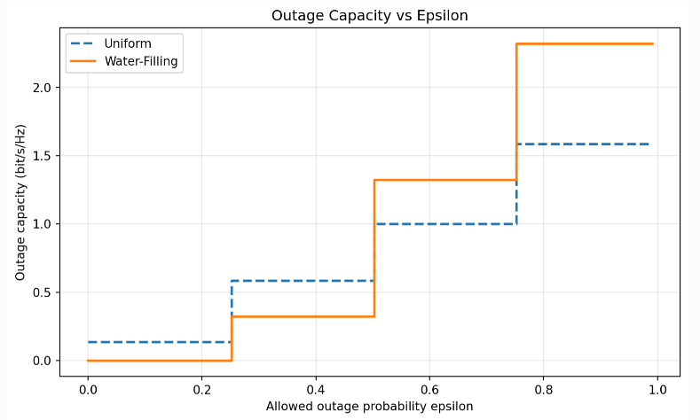

# گزارش شبیه‌سازی تخصیص توان بهینه در کانال فیدینگ گسسته با الگوریتم Water-Filling

## چکیده
در این پروژه، ظرفیت متوسط یک کانال فیدینگ گسسته با چهار حالت کانالی بررسی می‌شود. دو روش تخصیص توان یکنواخت و تخصیص توان بهینه با الگوریتم **Water-Filling** پیاده‌سازی و مقایسه شده‌اند. سطح آب با روش **جست‌وجوی دودویی (Bisection)** تعیین می‌شود تا قید توان متوسط برقرار باشد. برای پارامترهای مسئله، ظرفیت روش یکنواخت تقریباً `0.826857` و ظرفیت روش Water-Filling تقریباً `0.991446` بیت‌برثانیه‌برهرتز به دست می‌آید؛ بهبود نسبی حدود `19.91%` است.

## ۱. هدف پروژه
هدف، بیشینه‌سازی ظرفیت متوسط کانال با اطلاع فرستنده و گیرنده از وضعیت کانال (CSI) و تحت محدودیت توان متوسط ارسال است. در این مدل، کانال در هر نوبت استفاده یکی از چهار حالت را اختیار می‌کند؛ این چهار حالت **چهار زیرکانال هم‌زمان نیستند**.

## ۲. پارامترهای شبیه‌سازی

| پارامتر | نماد | مقدار |
|---|---|---|
| بهره توان حالت‌های کانال | $g_i$ | $[0.1,\ 0.5,\ 1,\ 2]$ |
| احتمال هر حالت | $p_i$ | $0.25$ |
| توان نویز | $N_0$ | $1$ |
| محدودیت توان متوسط | $P_{\mathrm{avg}}$ | $1$ |
| تعداد تکرار جست‌وجوی دودویی اصلی | — | $200$ |
| تعداد نقاط منحنی ظرفیت | — | $150$ |
| بازه توان متوسط در نمودار دوم | — | $[0.01,10]$ |

مدل دریافتی در حالت $i$ را می‌توان به‌صورت زیر نوشت:

$$y=\sqrt{g_i}x+n,\qquad n\sim\mathcal{CN}(0,N_0).$$

ظرفیت لحظه‌ای نرمال‌شده بر پهنای باند در حالت $i$ برابر است با:

$$C_i=\log_2\!\left(1+\frac{g_iP_i}{N_0}\right).$$

## ۳. روش اول: تخصیص توان یکنواخت

در این روش، توان ارسالی مستقل از وضعیت کانال است:

$$P_i=P_{\mathrm{avg}}=1,\qquad i=1,\ldots,4.$$

ظرفیت متوسط از رابطه زیر به دست می‌آید:

$$C_{\mathrm{uniform}}=\sum_{i=1}^{4}p_i\log_2\!\left(1+\frac{g_iP_{\mathrm{avg}}}{N_0}\right).$$

با جایگذاری مقادیر:

$$C_{\mathrm{uniform}}=\frac14\left[\log_2(1.1)+\log_2(1.5)+\log_2(2)+\log_2(3)\right]$$

$$\boxed{C_{\mathrm{uniform}}\approx0.826857\ \mathrm{bit/s/Hz}}.$$

## ۴. روش دوم: تخصیص توان بهینه Water-Filling

مسئله بهینه‌سازی:

$$\max_{P_i\ge0}\ \sum_{i=1}^{4}p_i\log_2\!\left(1+\frac{g_iP_i}{N_0}\right)$$

با قید:

$$\sum_{i=1}^{4}p_iP_i\le P_{\mathrm{avg}}.$$

با تشکیل لاگرانژ و اعمال شرایط KKT، برای حالت‌های فعال داریم:

$$\frac{g_i}{\ln 2\,(N_0+g_iP_i)}=\lambda.$$

با تعریف $\mu=1/(\lambda\ln2)$، رابطه بهینه تخصیص توان به شکل زیر درمی‌آید:

$$\boxed{P_i^*=\max\!\left(\mu-\frac{N_0}{g_i},0\right)}.$$

سطح نویز مؤثر در هر حالت:

$$\frac{N_0}{g_i}=[10,\ 2,\ 1,\ 0.5].$$

برای تعیین سطح آب، شرط برابری توان متوسط را حل می‌کنیم:

$$\sum_{i=1}^{4}p_i\max\!\left(\mu-\frac{N_0}{g_i},0\right)=1.$$

حالت اول با سطح نویز مؤثر ۱۰ غیرفعال می‌شود. برای سه حالت دیگر:

$$\frac14\left[(\mu-2)+(\mu-1)+(\mu-0.5)\right]=1$$

$$3\mu-3.5=4\quad\Longrightarrow\quad\boxed{\mu=2.5}.$$

بنابراین:

$$\boxed{P_{\mathrm{WF}}=[0,\ 0.5,\ 1.5,\ 2]}.$$

کنترل قید توان:

$$\sum_i p_iP_i=0.25(0+0.5+1.5+2)=1.$$

ظرفیت بهینه:

$$C_{\mathrm{WF}}=\frac14\left[\log_2(1)+\log_2(1.25)+\log_2(2.5)+\log_2(5)\right]$$

$$\boxed{C_{\mathrm{WF}}\approx0.991446\ \mathrm{bit/s/Hz}}.$$

## ۵. پیاده‌سازی عددی با روش Bisection

در کد MATLAB، ابتدا سطح نویز مؤثر محاسبه می‌شود:

```matlab
noiseLevel = N0 ./ g;
```

سپس در هر تکرار سطح آب آزمایشی محاسبه می‌شود:

```matlab
mu = (mu_low + mu_high)/2;
P_test = max(mu - noiseLevel, 0);
avgPower = sum(prob .* P_test);
```

اگر توان متوسط آزمایشی بیشتر از بودجه باشد، کران بالای سطح آب کاهش می‌یابد؛ در غیر این صورت کران پایین افزایش پیدا می‌کند. پس از ۲۰۰ تکرار، مقدار نهایی سطح آب و توان‌های بهینه محاسبه می‌شود. این روش برای تابع یکنواخت صعودی توان متوسط نسبت به $\mu$ مناسب است.

## ۶. نتایج عددی

| کمیت | مقدار |
|---|---:|
| سطح آب بهینه $\mu$ | `2.500000` |
| توان‌های یکنواخت | `[1, 1, 1, 1]` |
| توان‌های Water-Filling | `[0, 0.5, 1.5, 2]` |
| توان متوسط Water-Filling | `1.000000` |
| ظرفیت تخصیص یکنواخت | `0.826857 bit/s/Hz` |
| ظرفیت Water-Filling | `0.991446 bit/s/Hz` |
| درصد بهبود ظرفیت | `19.91%` |

درصد بهبود با رابطه زیر محاسبه شده است:

$$\mathrm{Improvement}=100\left(\frac{C_{\mathrm{WF}}}{C_{\mathrm{uniform}}}-1\right)\approx19.91\%.$$

## ۷. تحلیل نمودارها و نتایج شبیه‌سازی

در این بخش، نتایج شبیه‌سازی الگوریتم Water-Filling از نظر تخصیص توان، ظرفیت متوسط، ظرفیت ارگادیک و رفتار قطع ارتباط (Outage) بررسی می‌شوند.

### ۷.۱. مقایسه تخصیص توان (Power Allocation Comparison)



این نمودار توان اختصاص‌یافته به هر یک از چهار وضعیت کانال را برای دو روش تخصیص توان یکنواخت و Water-Filling مقایسه می‌کند.

در روش تخصیص توان یکنواخت، توان ارسالی در تمام وضعیت‌های کانال برابر است:

$$
P_{\mathrm{uniform}}=[1,1,1,1]
$$

اما در روش Water-Filling، تخصیص توان بر اساس کیفیت کانال انجام می‌شود:

$$
P_{\mathrm{WF}}=[0,0.5,1.5,2]
$$

**تحلیل نتایج:**

- در ضعیف‌ترین وضعیت کانال با بهره $g=0.1$، توان ارسالی صفر است؛ زیرا ارسال در این وضعیت از نظر افزایش ظرفیت به‌صرفه نیست.
- در وضعیت دوم با بهره $g=0.5$، توان تخصیص‌یافته برابر $0.5$ است.
- در وضعیت سوم با بهره $g=1$، توان به $1.5$ افزایش می‌یابد.
- در بهترین وضعیت کانال با بهره $g=2$، بیشترین توان یعنی $2$ اختصاص داده می‌شود.

با وجود تفاوت در تخصیص توان، هر دو روش قید توان متوسط یکسانی دارند:

$$
\sum_{i=1}^{4}p_iP_i=1
$$

**نتیجه مخابراتی:**

الگوریتم Water-Filling با حذف ارسال در وضعیت‌های بسیار ضعیف و انتقال توان به وضعیت‌های مناسب‌تر، از انرژی موجود به شکل مؤثرتری استفاده می‌کند. این ویژگی مبنای افزایش ظرفیت متوسط در سیستم‌های دارای اطلاعات وضعیت کانال در فرستنده است.

---

### ۷.۲. مقایسه ظرفیت کانال (Capacity Comparison)



این نمودار ظرفیت متوسط کانال را در دو روش تخصیص توان یکنواخت و Water-Filling برای توان متوسط برابر با یک مقایسه می‌کند.

نتایج عددی به صورت زیر هستند:

| روش تخصیص توان | ظرفیت (bit/s/Hz) |
|---|---:|
| Uniform Power Allocation | 0.826857 |
| Water-Filling | 0.991446 |

اختلاف ظرفیت دو روش برابر است با:

$$
\Delta C=C_{\mathrm{WF}}-C_{\mathrm{uniform}}
$$

$$
\Delta C=0.991446-0.826857
$$

$$
\boxed{\Delta C=0.164589\ \mathrm{bit/s/Hz}}
$$


**تحلیل نتایج:**

روش Water-Filling با وجود استفاده از همان بودجه توان متوسط، ظرفیت بیشتری نسبت به روش یکنواخت ایجاد می‌کند.

علت این افزایش، بهره‌برداری بهتر از تغییرات کیفیت کانال است. در روش یکنواخت، بخشی از انرژی در وضعیت‌هایی مصرف می‌شود که بازده ظرفیت پایینی دارند؛ درحالی‌که Water-Filling توان را با توجه به بهره کانال تنظیم می‌کند.

**نتیجه مخابراتی:**

افزایش ظرفیت بدون افزایش توان متوسط نشان می‌دهد که استفاده از اطلاعات وضعیت کانال و کنترل تطبیقی توان می‌تواند بازده طیفی سیستم مخابراتی را بهبود دهد.

---

### ۷.۳. ظرفیت برحسب توان متوسط (Capacity vs. Average Power)



این نمودار تغییرات ظرفیت متوسط کانال را برحسب توان متوسط ارسال در بازه زیر نشان می‌دهد:

$$
0.01\le P_{\mathrm{avg}}\le10
$$

**تحلیل نتایج:**

**۱. ناحیه توان پایین (Low-SNR Region)**

در توان‌های پایین، انرژی ارسالی محدود است و استفاده از آن در وضعیت‌های ضعیف کانال بازده کمی دارد.

الگوریتم Water-Filling می‌تواند بخش عمده یا تمام توان را به بهترین وضعیت کانال اختصاص دهد. بنابراین در این ناحیه، تخصیص تطبیقی توان اهمیت زیادی دارد.

**۲. ناحیه توان متوسط (Moderate-SNR Region)**

با افزایش توان متوسط، سطح آب افزایش می‌یابد و وضعیت‌های بیشتری از کانال فعال می‌شوند.

در این ناحیه، الگوریتم Water-Filling توان را بین چند وضعیت مناسب تقسیم می‌کند و همچنان ظرفیت آن از روش یکنواخت کمتر نخواهد بود.

**۳. ناحیه توان بالا (High-SNR Region)**

در توان‌های بالا، همه وضعیت‌های کانال می‌توانند فعال شوند.

در این شرایط، اختلاف نسبی توان‌های تخصیص‌یافته کاهش پیدا می‌کند و مزیت نسبی ظرفیت Water-Filling نسبت به تخصیص یکنواخت به سمت صفر میل می‌کند.

از نظر ریاضی:

$$
\lim_{P_{\mathrm{avg}}\to\infty}
\frac{C_{\mathrm{WF}}}
{C_{\mathrm{uniform}}}=1
$$

**نتیجه مخابراتی:**

مزیت نسبی Water-Filling در توان‌های پایین بیشتر اهمیت پیدا می‌کند؛ زیرا در این شرایط، انتخاب وضعیت مناسب برای ارسال می‌تواند بهره‌وری انرژی و ظرفیت را بهبود دهد.

---

### ۷.۴. احتمال قطع برحسب نرخ هدف (Outage Probability vs. Target Rate)



این نمودار احتمال قطع ارتباط را برحسب نرخ انتقال هدف $R$ بررسی می‌کند.

**تحلیل نتایج:**

- در نرخ‌های هدف پایین، احتمال اینکه ظرفیت لحظه‌ای کانال کمتر از نرخ موردنیاز باشد، پایین‌تر است.
- با افزایش نرخ هدف، تعداد وضعیت‌هایی که قادر به پشتیبانی از نرخ موردنظر نیستند افزایش می‌یابد.
- در نتیجه، احتمال قطع تابعی غیرکاهشی از نرخ هدف است.
- از آنجا که مدل کانال تنها چهار وضعیت گسسته دارد، منحنی احتمال قطع به صورت پله‌ای ظاهر می‌شود.
- با برابر بودن احتمال چهار وضعیت، هر وضعیت جدیدی که وارد ناحیه قطع شود، احتمال قطع را به اندازه $0.25$ افزایش می‌دهد.

بنابراین مقادیر ممکن احتمال قطع در این مدل عبارت‌اند از:

$$
P_{\mathrm{out}}\in
\{0,0.25,0.5,0.75,1\}
$$

**تفسیر مخابراتی:**

افزایش نرخ انتقال هدف، نیاز به کیفیت بالاتر کانال را افزایش می‌دهد. در نتیجه، سیستم با احتمال بیشتری قادر به پشتیبانی از نرخ انتخاب‌شده نخواهد بود.

این نمودار رابطه میان سرعت انتقال داده و قابلیت اطمینان ارتباط را نشان می‌دهد.

**نکته مهم:**

کمینه‌سازی احتمال قطع لزوماً معادل بیشینه‌سازی ظرفیت ارگادیک نیست. بنابراین Water-Filling که برای بیشینه‌سازی ظرفیت متوسط طراحی شده است، الزاماً بهترین سیاست برای کمینه‌سازی احتمال قطع در یک نرخ هدف مشخص نیست.

---

### ۷.۵. ظرفیت قطع برحسب احتمال قطع مجاز (Outage Capacity vs. Epsilon)



این نمودار ظرفیت قطع را برحسب احتمال قطع مجاز $\epsilon$ نشان می‌دهد.

**تحلیل نتایج:**

**۱. احتمال قطع مجاز پایین**

هنگامی که $\epsilon$ کوچک باشد، سیستم باید نرخ انتقالی انتخاب کند که در بیشتر وضعیت‌های کانال قابل پشتیبانی باشد.

بنابراین ظرفیت قطع محدودتر خواهد بود.

**۲. افزایش احتمال قطع مجاز**

با افزایش $\epsilon$، سیستم اجازه دارد در درصد بیشتری از وضعیت‌های کانال دچار قطع شود.

در نتیجه، می‌توان نرخ انتقال بالاتری انتخاب کرد:

$$
\epsilon_1<\epsilon_2
\quad\Longrightarrow\quad
C_{\mathrm{out}}(\epsilon_1)
\le
C_{\mathrm{out}}(\epsilon_2)
$$

**۳. رفتار پله‌ای نمودار**

به دلیل گسسته بودن وضعیت‌های کانال، ظرفیت قطع نیز می‌تواند به صورت پله‌ای تغییر کند.

در این مدل، هر وضعیت احتمال وقوع $0.25$ دارد. بنابراین عبور احتمال قطع مجاز از آستانه‌های مرتبط با این احتمال‌ها می‌تواند باعث افزایش ظرفیت قطع شود.

**نتیجه مخابراتی:**

این نمودار یک موازنه اساسی در طراحی سیستم‌های مخابراتی را نشان می‌دهد:

- قابلیت اطمینان بالاتر معمولاً نیازمند نرخ انتقال پایین‌تر است.
- پذیرش احتمال قطع بیشتر امکان انتخاب نرخ انتقال بالاتر را فراهم می‌کند.

بنابراین انتخاب $\epsilon$ به الزامات کیفیت سرویس (QoS) و میزان تحمل قطع ارتباط در کاربرد موردنظر وابسته است.

---
### ۷.۶. جمع‌بندی تحلیل نمودارها

بررسی پنج نمودار شبیه‌سازی نشان می‌دهد:

1. الگوریتم Water-Filling با تخصیص تطبیقی توان به وضعیت‌های مناسب‌تر کانال، ظرفیت متوسط را افزایش می‌دهد.
2. در توان متوسط برابر با یک، ظرفیت از $0.826857$ به $0.991446$ بیت‌برثانیه‌برهرتز افزایش یافته است.
3. بهبود نسبی ظرفیت در این سناریو تقریباً $19.91\%$ است.
4. مزیت تخصیص توان تطبیقی در ناحیه توان پایین از نظر نسبی اهمیت بیشتری دارد.
5. احتمال قطع با افزایش نرخ هدف، کاهش نمی‌یابد.
6. ظرفیت قطع با افزایش احتمال قطع مجاز، کاهش نمی‌یابد.
7. رفتار پله‌ای نمودارهای Outage ناشی از مدل گسسته چهارحالته کانال است.
8. بیشینه‌سازی ظرفیت متوسط و کمینه‌سازی احتمال قطع دو مسئله بهینه‌سازی متفاوت هستند.

در مجموع، نتایج نشان می‌دهند که طراحی مناسب سیاست تخصیص توان و انتخاب معیار عملکرد، نقش مهمی در افزایش بازده طیفی و کنترل قابلیت اطمینان سیستم‌های مخابرات بی‌سیم دارد.

## ۸. مفروضات و محدودیت‌ها

- کانال یک کانال فیدینگ گسسته چهارحالته است، نه چهار زیرکانال موازی هم‌زمان.
- بهره‌ها و احتمال‌های کانال از پیش معلوم و ثابت فرض شده‌اند.
- اطلاعات وضعیت کانال در فرستنده و گیرنده در دسترس فرض می‌شود.
- قید توان از نوع **توان متوسط** است؛ توان در هر حالت لزوماً برابر ۱ نیست.
- ظرفیت گزارش‌شده میانگین وزن‌دار ظرفیت حالت‌هاست؛ محاسبه احتمال قطع (Outage Probability) در این کد انجام نمی‌شود.
- نویز ثابت و برابر ۱ است و تغییرات کیفیت کانال از بهره $g_i$ ناشی می‌شود.

## ۹. جمع‌بندی

نتایج نشان می‌دهد الگوریتم Water-Filling با حذف تخصیص توان به حالت بسیار ضعیف و افزایش توان در حالت‌های مناسب‌تر، ظرفیت متوسط کانال را از حدود `0.826857` به `0.991446 bit/s/Hz` افزایش می‌دهد. در این سناریو، بهبود نسبی برابر `19.91%` است. در نتیجه، حتی با بودجه توان متوسط یکسان، آگاهی از وضعیت کانال و تخصیص توان تطبیقی می‌تواند بازده طیفی سیستم را افزایش دهد.

## ۱۰. نحوه اجرا

کد اصلی را در یک فایل `.m` ذخیره کرده و در MATLAB اجرا کنید. خروجی شامل مقادیر عددی در Command Window و دو نمودار است: **مقایسه تخصیص توان** و **مقایسه ظرفیت برحسب توان متوسط**.
