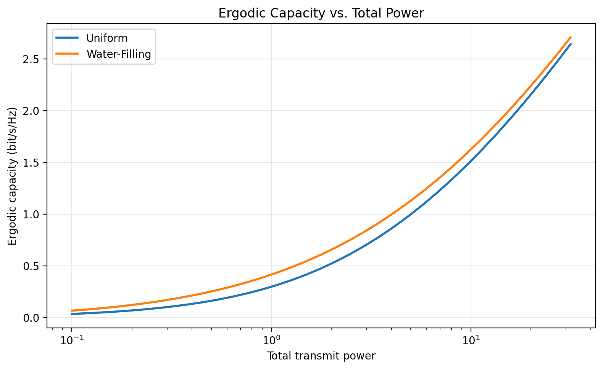
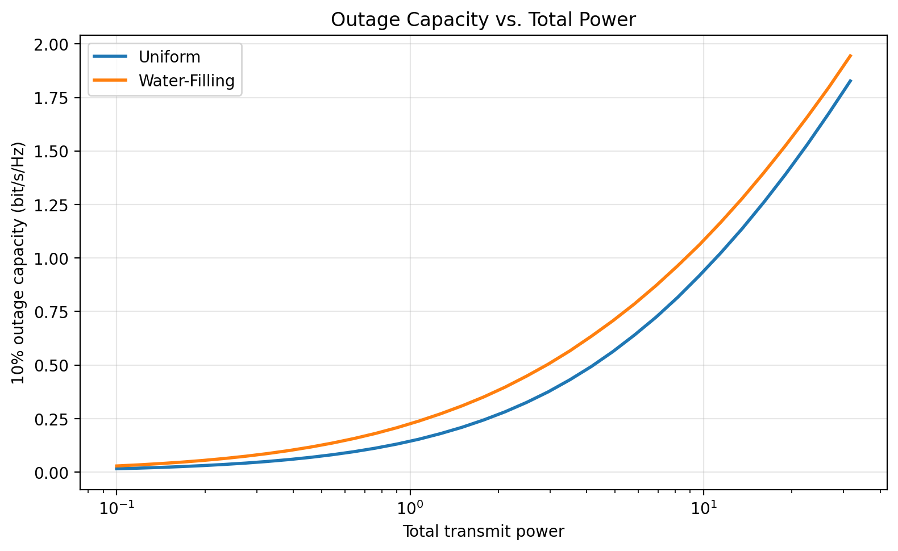
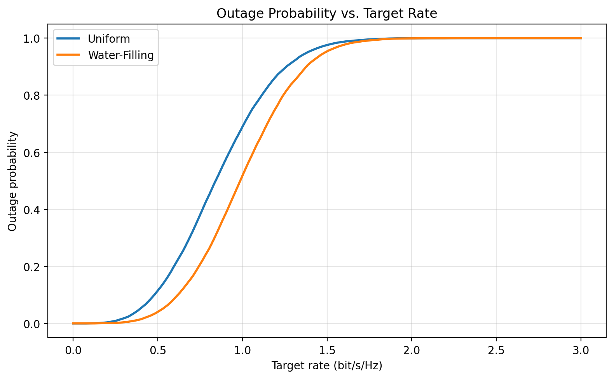
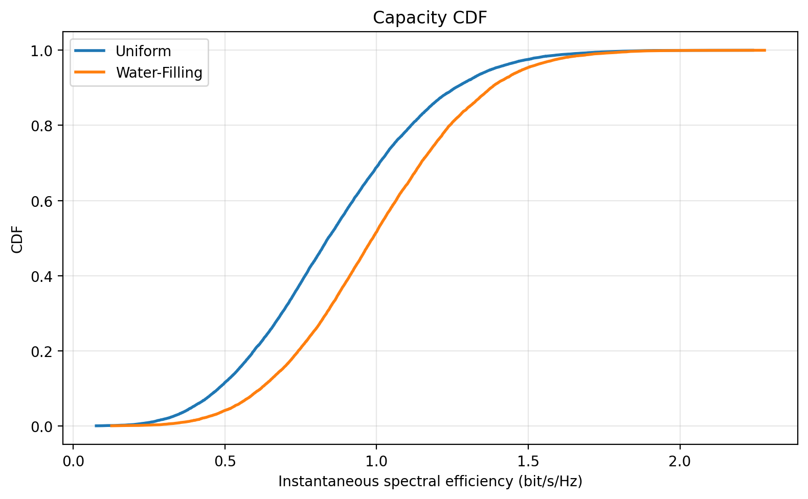

# Water-Filling vs. Uniform Power Allocation in Rayleigh Fading Channels

**MATLAB simulation | Four parallel subchannels | Ergodic capacity | Outage capacity | Outage probability**

This project compares **uniform power allocation** with **instantaneous water-filling** over four independent parallel Rayleigh-fading subchannels. It uses Monte Carlo simulation to study how channel-aware power allocation changes spectral efficiency and outage performance under a **fixed total transmit-power constraint for each channel realization**.

## Highlights

- Simulates **20,000** independent realizations of four Rayleigh-fading subchannels.
- Solves the water-filling power-allocation problem using **65 iterations of bisection** per realization (vectorized across realizations).
- Compares instantaneous and ergodic spectral efficiency, 10% outage capacity, outage probability, and empirical capacity CDF.
- Automatically saves **five figures** to `Figures/`.
- Uses a fixed MATLAB random seed for reproducibility and a custom quantile function (no Statistics and Machine Learning Toolbox required).

## System Model

For subchannel $i$, let the complex channel coefficient and power gain be

$$
h_i \sim \mathcal{CN}(0,1), \qquad g_i = |h_i|^2.
$$

Consequently, $g_i$ has an exponential distribution with unit mean. The code generates these gains via inverse-transform sampling: `g = -log(max(rand(numTrials,N),realmin));`.

For $N=4$ subchannels, the normalized instantaneous spectral efficiency is

$$
C(\mathbf{g},\mathbf{P}) = \frac{1}{N}\sum_{i=1}^{N}\log_2\left(1+\frac{g_iP_i}{N_0}\right).
$$

The total power constraint is applied **separately to each realization**:

$$
\sum_{i=1}^{N}P_i=P_{\mathrm{total}}, \qquad P_i\geq0.
$$

The division by $N$ is intentional: reported capacities are **spectral efficiencies normalized by the number of equal-bandwidth subchannels**, not the unnormalized sum of their rates.

### Allocation strategies

**Uniform allocation** assigns equal power to every subchannel:

$$
P_i^{\mathrm{U}}=\frac{P_{\mathrm{total}}}{N}.
$$

**Water-filling** maximizes instantaneous spectral efficiency for the observed channel gains:

$$
P_i^{\mathrm{WF}}=\max\left(\mu-\frac{N_0}{g_i},0\right),
$$

where the water level $\mu$ is chosen to satisfy the total-power constraint. This strategy assumes **perfect instantaneous channel-state information at the transmitter (CSIT)**. It is not long-term temporal water-filling under an average-power-across-fading-states constraint.

## Simulation Parameters

| Parameter | Value |
|---|---:|
| Number of subchannels | 4 |
| Fading model | Independent Rayleigh fading; unit-mean exponential power gains |
| Monte Carlo realizations | 20,000 |
| Noise power per subchannel | 1 |
| Baseline total transmit power | 4 |
| Outage probability threshold | 10% |
| Transmit-power sweep | 35 logarithmically spaced points, 0.1 to approximately 31.62 |
| Target-rate sweep | 120 points, 0 to 3 bit/s/Hz |
| Bisection iterations | 65 |
| MATLAB random seed | `rng(42,'twister')` |

## Results and Interpretation

### Example: allocation across four unequal channels

For a single illustrative channel realization,

$$
\mathbf{g}=[0.1,\ 0.5,\ 1,\ 2],
$$

with $P_{\mathrm{total}}=4$ and $N_0=1$:

| Method | Subchannel 1 | Subchannel 2 | Subchannel 3 | Subchannel 4 |
|---|---:|---:|---:|---:|
| Uniform | 1 | 1 | 1 | 1 |
| Water-filling | 0 | 0.5 | 1.5 | 2 |

Water-filling shuts off the weakest subchannel and reallocates its power to the stronger ones.


### Ergodic capacity versus total transmit power

The ergodic spectral efficiency is the mean of instantaneous spectral efficiencies across channel realizations:

$$
C_{\mathrm{erg}}=\mathbb{E}_{\mathbf{g}}[C(\mathbf{g})].
$$

Water-filling provides at least as much instantaneous capacity as uniform allocation under the same per-realization power constraint. The relative advantage is generally more pronounced at low power.



### 10% outage capacity versus total transmit power

The 10% outage capacity is estimated from the lower 10th percentile of the simulated instantaneous-capacity distribution. Higher values indicate that a higher target rate can be supported at approximately the same 10% outage level.



### Outage probability versus target rate

For target rate $R$, outage occurs when the instantaneous capacity falls below $R$:

$$
P_{\mathrm{out}}(R)=\Pr(C<R).
$$

The probability of outage increases as the target rate rises. Since water-filling maximizes capacity for each channel realization, its outage probability is no greater than uniform allocation's at a fixed target rate.



### Empirical capacity CDF

The cumulative distribution function (CDF) describes the fraction of channel realizations whose instantaneous spectral efficiency is below a threshold. The water-filling curve shifts toward higher spectral efficiencies relative to uniform allocation.



### Numerical results

The following values are **illustrative estimates from an independent Monte Carlo run with equivalent model parameters**, rather than verified output from the supplied MATLAB random sequence. For exact reproducible figures, use the values printed in the MATLAB Command Window after running the script.

| Metric at total power = 4 | Uniform | Water-filling |
|---|---:|---:|
| Ergodic spectral efficiency (bit/s/Hz) | 0.8602 | 0.9957 |
| 10% outage spectral efficiency (bit/s/Hz) | 0.4795 | 0.6196 |

The illustrative relative improvement is approximately **15.75%** in ergodic spectral efficiency and **29.21%** in 10% outage spectral efficiency. Monte Carlo estimates vary slightly with the random-number generator and realization sample.

## Repository Structure

```text
water-filling/
├── README.md
├── water_filling_simulation.m
├── SIMULATION_RESULTS.md          # Optional detailed report
└── Figures/
    ├── power_allocation_comparison.png
    ├── ergodic_capacity_vs_power.png
    ├── outage_capacity_vs_power.png
    ├── outage_probability_vs_rate.png
    └── capacity_cdf.png
```

## How to Run

1. Open MATLAB (R2016b or newer for local functions in scripts).
2. Set the current folder to the repository root.
3. Run:

   ```matlab
   water_filling_simulation
   ```

4. Read the printed ergodic and 10% outage capacities in the Command Window.
5. Find the five generated PNG files in `Figures/`.

The script checks that water-filling satisfies the total-power constraint and never produces a lower instantaneous capacity than uniform allocation, up to numerical tolerance.

## Limitations

The model assumes independent fading across subchannels, equal noise power, perfect CSIT, ideal capacity-achieving coding, and no channel-estimation or feedback overhead. Its results characterize a **per-realization total-power-constrained** system and should not be interpreted as results for long-term average-power adaptation across fading states.

## Conclusion

For four parallel Rayleigh-fading subchannels, instantaneous water-filling uses channel-state information to redistribute power toward stronger subchannels. Under the simulated per-realization power constraint, this maximizes instantaneous spectral efficiency, improves or preserves ergodic and outage capacities, and does not increase outage probability relative to uniform allocation.

**Keywords:** Water-Filling, Rayleigh Fading, Parallel Channels, Power Allocation, Monte Carlo, MATLAB, Ergodic Capacity, Outage Capacity.
