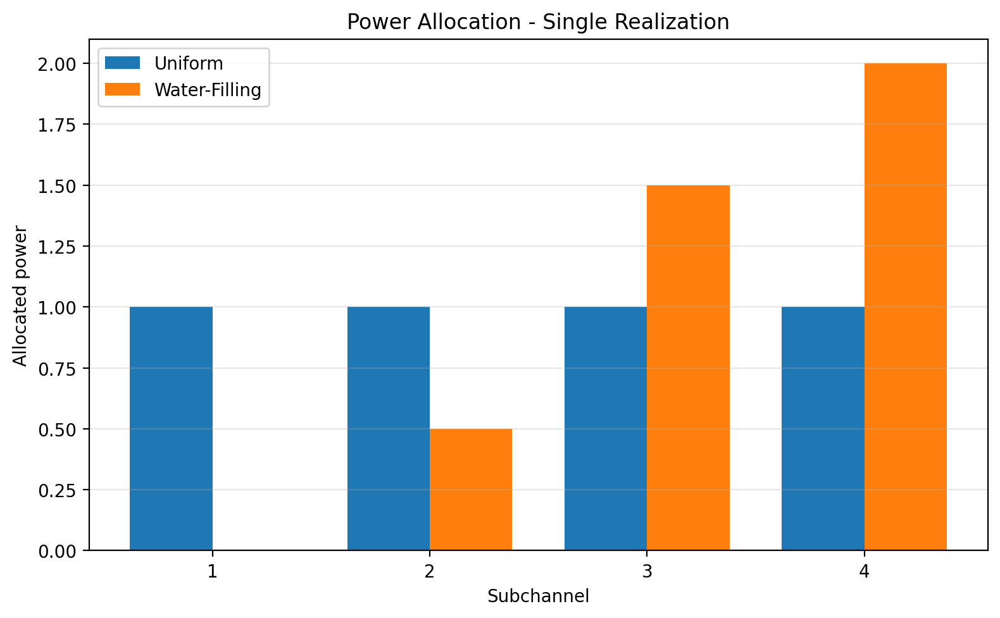
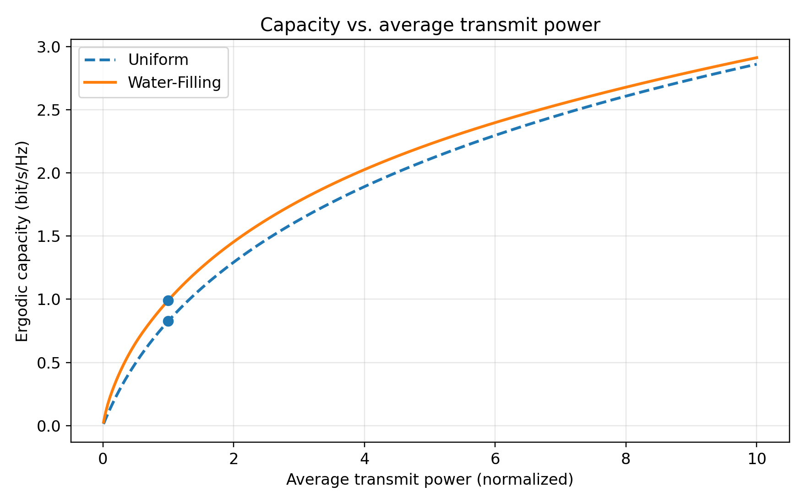
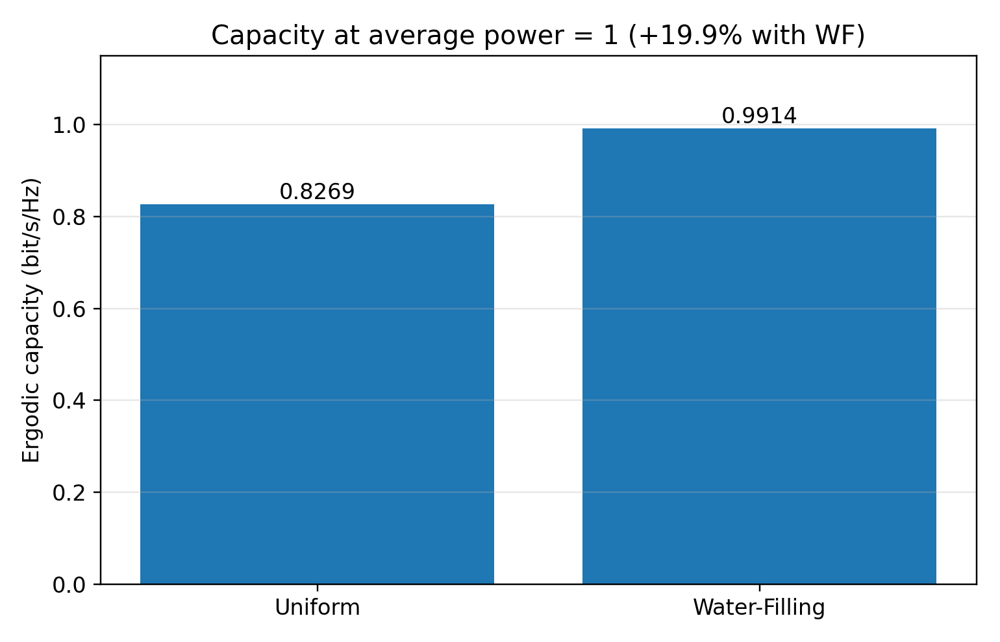

# Water-Filling Power Allocation in Discrete Fading Channels

A MATLAB simulation comparing **optimal water-filling power allocation** with **uniform power allocation** for a discrete-state fading channel under an average transmit-power constraint.

## Overview

Wireless channel quality varies over time due to fading. When the transmitter and receiver both know the instantaneous channel state (perfect CSI), the transmitter can adapt its power to improve the average achievable rate.

This project evaluates two strategies:

- **Uniform allocation:** transmit with the same power in every fading state.
- **Water-filling allocation:** adapt power to the channel gain, potentially transmitting no power in poor channel states.

The simulation uses a finite set of **mutually exclusive temporal fading states**, not simultaneously active parallel subchannels.

## System Model

For channel state $i$:

$$
y_i = h_i x_i + n_i, \qquad g_i = |h_i|^2.
$$

Let $p_i$ be the probability of state $i$, $P_i$ the transmit power used in that state, and $N$ the receiver noise power. The average spectral efficiency is

$$
C = \sum_{i=1}^{M} p_i \log_2\left(1 + \frac{g_i P_i}{N}\right)
$$

in bits/s/Hz, subject to

$$
\sum_{i=1}^{M} p_i P_i \leq \bar P,
\qquad P_i \geq 0.
$$

> **Notation:** The MATLAB variable `N0` represents the noise **power** $N$ in this normalized model, not a noise power spectral density in W/Hz.

### Uniform Power Allocation

Because the states occur at different times and their probabilities sum to one, uniform allocation uses $P_i=\bar P$ in every state (rather than dividing $\bar P$ by the number of states):

$$
C_{\mathrm{uniform}} =
\sum_i p_i \log_2\left(1+\frac{g_i\bar P}{N}\right).
$$

### Optimal Water-Filling Allocation

The capacity-maximizing allocation is

$$
P_i^* = \left(\mu-\frac{N}{g_i}\right)^+,
\qquad (z)^+ = \max(z,0),
$$

where the water level $\mu$ satisfies

$$
\sum_i p_i \left(\mu-\frac{N}{g_i}\right)^+ = \bar P.
$$

The code solves this equation numerically using **bisection**.

## Example Configuration

| Parameter | Value |
|---|---|
| Channel power gains, `g` | `[0.1 0.5 1 2]` |
| State probabilities, `prob` | `[0.25 0.25 0.25 0.25]` |
| Noise power, `N0` | `1` |
| Average transmit power, `Pavg` | `1` |

### Expected Results

| Metric | Uniform | Water-Filling |
|---|---:|---:|
| State-wise transmit power | `[1 1 1 1]` | `[0 0.5 1.5 2]` |
| Average transmit power | `1` | `1` |
| Spectral efficiency | ~`0.827` bits/s/Hz | ~`0.991` bits/s/Hz |

The water level is $\mu=2.5$. In this example, water-filling increases spectral efficiency by approximately **19.9%** relative to uniform allocation.

The exact improvement depends on the channel-state gains, probabilities, noise power, and average-power budget.

## Simulation Figures

The following figures were generated for the four-state fading example above.

All image paths are relative to the repository root, so they render directly on GitHub when the `figures/` directory is uploaded alongside this README.

### 1. Power Allocation by Fading State



Uniform allocation uses the same transmit power in all four states.

Water-filling turns off transmission in the weakest state and allocates more power to stronger states while respecting the same **average** power constraint.

### 2. Channel Capacity versus Average Transmit Power



Both strategies improve as the available average power increases.

Water-filling achieves at least the spectral efficiency of uniform allocation at each power level.

### 3. Capacity Comparison at Normalized Average Power = 1



| Allocation | Capacity (bit/s/Hz) |
|---|---:|
| Uniform | 0.8269 |
| Water-Filling | 0.9914 |

**Relative improvement: 19.91%.**

Numerical values are calculated for the example parameters listed above.

The underlying data are available in [`figures/simulation_results.txt`](Figures/simulation_results.txt).

## MATLAB Implementation

The script:

1. Defines discrete fading-state gains and their probabilities.
2. Computes the uniform-allocation capacity.
3. Finds the water level using bisection under the average-power constraint.
4. Calculates the optimal state-dependent transmit powers and capacity.
5. Plots **power allocation by channel state**.
6. Sweeps the average transmit power and plots **capacity versus average power** for both strategies.

### Requirements

- MATLAB with standard numerical and plotting functions (no specialized toolbox required).

### Run

1. Clone or download the repository.
2. Open MATLAB and navigate to the project folder.
3. Run the simulation script (recommended filename: `water_filling_discrete_fading.m`):

```matlab
run('water_filling_discrete_fading.m')
```

The script prints the capacities, water level, average allocated power, and percentage improvement, then displays two figures.

## Suggested Repository Structure

```text
discrete-fading-water-filling-matlab/
├── README.md
├── water_filling_discrete_fading.m
├── Figures/
│   ├── power_allocation_comparison.png
│   ├── capacity_vs_average_power.png
│   ├── capacity_comparison.png
│   └── simulation_results.txt
└── LICENSE                   # Optional: choose a license
```

## Assumptions and Limitations

- Perfect, instantaneous CSI is available at both transmitter and receiver.
- Channel-state probabilities and gains are known and fixed during the optimization.
- The constraint is on **average transmit power**, not a per-state peak-power limit.
- Noise power is identical across channel states.
- Capacity is an average spectral-efficiency metric for the idealized Gaussian fading model; practical coding, estimation errors, and implementation overhead are not simulated.
- This is a **discrete-state temporal fading** model. For simultaneous parallel frequency channels, the power-budget formulation and uniform-allocation baseline must be adjusted.

## Background

This project illustrates the power-adaptation concepts covered in:

Andrea Goldsmith, *Wireless Communications*, Cambridge University Press, 2005, Chapter 4 (Capacity of Wireless Channels).

## License

No license is included by default. Add a `LICENSE` file if you want to define reuse and redistribution permissions.
